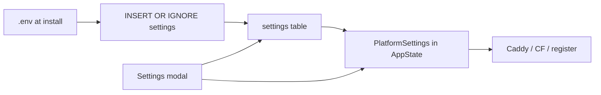

# Platform Domain & Settings

The platform domain is DB-backed and live-editable: Dashboard → Settings runs a confirmed domain-change job (preflight → progress → retry). Tryout installs get a full platform on a free sslip.io domain; production expects a real domain.

## Product stance

- **Production:** real domain (or subdomain as `DOMAIN`). Not an IP:port PaaS.
- **Tryout:** install may set `DOMAIN={public-ip-dashed}.sslip.io` (e.g. `203.0.113.5` → `203-0-113-5.sslip.io`). **Full LiteBin** — dashboard, app deploys, agents. LE may fail; user accepts (banner). No deploy block.
- **Agents on tryout:** yes. Master pushes the same sslip `DOMAIN` via `/internal/register`. Under **master_proxy**, public traffic still hits the master (`{project}.{DOMAIN}` → master IP); agents don't need their own sslip names.
- **Upgrade path:** Settings platform-domain change (preflight + progress job).
- **Master proxy DNS:** `*.{DOMAIN}` → LiteBin; **specific records override wildcards** (`mail.` / `app.` elsewhere OK). Apex ≠ wildcard. Or `DOMAIN=apps.example.com` + `*.apps.example.com`.
- **Cloudflare DNS:** `DOMAIN` may be a subdomain of the CF zone; sync only LiteBin-owned names under the platform DOMAIN suffix.
- **Tryout + Cloudflare:** not supported — tryout forces `master_proxy` (the sslip zone isn't user-controlled).
- **Tryout detection:** domain ending `.sslip.io` / `.nip.io` ⇒ `tryout` flag in `GET /settings` → dashboard banner ("not for production; LE may fail"). Warning-level in preflight; no functional lock.
- **Out of scope:** branded `nip.l8b.in` at scale (LE quota risk on a shared parent domain), bare-IP dashboard (rejected).

## Source of truth

| Field | Seed | Runtime | UI |
|---|---|---|---|
| `domain` | `.env` once | DB + in-memory | Heavy change flow |
| `dashboard_subdomain` | `.env` once | DB + in-memory | Simple save + sync |
| `poke_subdomain` | `.env` once | DB + in-memory | No UI |
| `dns_target` | empty / user | DB | Display-only field |
| `routing_mode`, CF token/zone | existing | DB (startup reads DB) | Existing |
| Infra (`PORT`, certs, `DATABASE_URL`, …) | `.env` | env forever | none |

Module: [`orchestrator/src/platform.rs`](../../orchestrator/src/platform.rs) — `PlatformHandle` / `PlatformSettings` / domain job types. Runtime code reads `state.platform.*`; `config.domain` survives only at startup/seed — there are no stale runtime reads.

## Change-flow defaults

- **Preflight:** Cloudflare mode hard-fails if the zone doesn't cover the new domain or the token can't manage records. Master-proxy: DNS resolve mismatch is a **warning**; the user must acknowledge DNS before apply.
- **After apply:** show the new dashboard URL; re-login on the new host is required. No automatic rollback to the old domain.
- **Cloudflare cleanup on apply:** deletes only the LiteBin-managed records under the old domain (see [DNS record ledger](#dns-record-ledger)), then syncs under the new domain. Records the user created themselves are never touched.
- **Poke subdomain:** no Settings UI (PATCH-able via API only).
- **`dns_target`:** display-only DB field (no sync side effects).

### Changing the domain without the dashboard

Two paths, for when the dashboard is reachable or not:

| Path | Command | Notes |
|---|---|---|
| CLI (admin token) | `l8b platform domain set <domain> [--ack-dns] [--timeout N]` | Preflight → apply → polls the job; `l8b platform domain show` reports the current domain (falls back to read-scoped `/meta` without admin). |
| On-server recovery | `curl -fsSL https://l8b.in \| sudo bash -s set-domain <domain>` | Domain-expiry lockout: execs the orchestrator's offline `set-domain` subcommand (`docker exec litebin-orchestrator /app/litebin-orchestrator set-domain <domain>`) and restarts it. Re-registers online agents best-effort; boot route sync rebuilds Caddy/DNS/agent configs from the DB value. Editing `.env` `DOMAIN` does **not** work — it is an `INSERT OR IGNORE` seed and the DB row wins. |

## DNS record ledger

Every Cloudflare record LiteBin creates is recorded in the `dns_records` table (name → Cloudflare record ID; [`orchestrator/src/dns_ledger.rs`](../../orchestrator/src/dns_ledger.rs)). All deletion decisions — stale-record cleanup during syncs, domain-change cleanup, and "Remove Cloudflare & Cleanup DNS" — are made from this ledger, never by suffix-sweeping the zone: records you created yourself (e.g. `mail.{domain}` at a zone apex) are never touched. Records created before the ledger existed are backfilled on the first sync (the read-only suffix listing provides their IDs). A "record does not exist" (81047) response drops the stale row silently.

## API surface

Routes in [`orchestrator/src/routes/global_settings/`](../../orchestrator/src/routes/global_settings) (`mod.rs`, `domain_job.rs`, `dns_ops.rs`), admin scope:

| Method | Path | Role |
|---|---|---|
| `GET` | `/settings` | Live domain + `tryout` flag |
| `PATCH` | `/settings` | Rejects `domain`; dashboard subdomain → sync routes + re-register agents |
| `POST` | `/settings/domain/preflight` | `{ domain }` → `{ ok, errors[], warnings[] }` |
| `POST` | `/settings/domain/apply` | `{ domain, acknowledge_dns }` → `{ job_id }` (409 if a job is pending/running) |
| `GET` | `/settings/domain/jobs/{id}` | Poll steps |
| `POST` | `/settings/domain/jobs/{id}/retry` | Resume a failed job from the failed step |

Apply steps, in order: `persist` → `routes` (rebuild master routes) → `agents` (re-register) → `agent_caddy` (push agent configs) → `dns` (CF cleanup + sync; `Skipped` in master_proxy) → completed.

## Frontend

[`dashboard/src/components/settings/GeneralPanel.tsx`](../../dashboard/src/components/settings/GeneralPanel.tsx) — domain read-only + Change modal (type-to-confirm, preflight errors/warnings + ack checkbox, 800 ms progress polling, per-step status, retry from failed step, final dashboard URL + "sign in again"). Tryout banner. Save never sends `domain`.

## Install tryout

[`install.sh`](../../install.sh) master prompts: detect public IP (ipify → checkip → icanhazip) → "Domain or subdomain ready?" — **Yes** → domain + dashboard/poke + routing + CF prompts; **No** → `DOMAIN={ip-dashed}.sslip.io`, `master_proxy` forced, CF prompts skipped, tryout warnings shown.

## Key call sites (use `state.platform.*`, not `config.domain`)

- [`orchestrator/src/routing_helpers.rs`](../../orchestrator/src/routing_helpers.rs)
- [`orchestrator/src/routes/nodes/connect.rs`](../../orchestrator/src/routes/nodes/connect.rs) (`reregister_online_agents`)
- [`orchestrator/src/nodes/heartbeat.rs`](../../orchestrator/src/nodes/heartbeat.rs)
- deploy ([`routes/deploy/`](../../orchestrator/src/routes/deploy)) / waker / caddy / janitor / reconciliation / activity

## Not built (future)

- **Domain job persistence** — jobs live in an in-memory `DashMap`; a restart loses in-flight job status (the domain value itself stays in DB).
- **Hardening tests** — preflight / apply / retry, dashboard-subdomain sync, tryout install → deploy + agent register, sslip → real-domain migration, CF cleanup scoping. None exist today.
